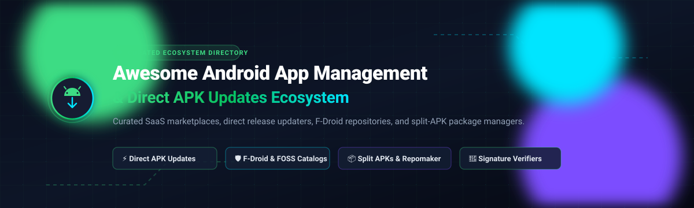

# 📱 Awesome Android App Management & Direct APK Updates

**The ultimate curated directory of alternative Android app stores, direct APK/APKM release updaters, F-Droid repositories, package managers, and cryptographic installation verification suites.**

*Empowering Android power users, privacy advocates, de-Googled device enthusiasts, sysadmins, and FOSS developers with user-controlled app distribution.*

---

## 📑 Table of Contents

- [🌐 Sector Overview & Market Dynamics](#-sector-overview--market-dynamics)
- [☁️ SaaS & Hosted App Distribution Platforms](#️-saas--hosted-app-distribution-platforms)
- [🛠️ Open-Source Android App Managers & Updaters](#️-open-source-android-app-managers--updaters)
- [📦 Advanced Ecosystem Tools & Verification Frameworks](#-advanced-ecosystem-tools--verification-frameworks)
- [🤝 How to Contribute](#-how-to-contribute)
- [💖 Support & Sponsor](#-support--sponsor)
- [⭐ Star History](#-star-history)
- [⚠️ Disclaimer](#️-disclaimer)

---

## 🌐 Sector Overview & Market Dynamics

The global third-party Android application distribution and mobile app management sector is estimated at roughly **$4B–$6B annually** (as part of the broader **$200B+** mobile app store and enterprise mobility ecosystem). 

The market exhibits a distinct bifurcated structure:
- **Commercial Hosted App Stores:** Moderately concentrated around deep-pocketed tech giants (e.g., Amazon Appstore with multi-billion dollar parent valuation) and major independent distribution networks (Aptoide, Uptodown, APKPure) alongside regional OEM marketplaces.
- **Direct-Update & FOSS Ecosystem:** Highly fragmented, community-driven, and decentralized. Tools like Obtainium, F-Droid, Droid-ify, and Shizuku enable users to bypass centralized commercial intermediaries completely by consuming raw release payloads directly from source forge tags (GitHub, GitLab, Forgejo).

---

## ☁️ SaaS & Hosted App Distribution Platforms

Commercial and cloud-hosted third-party app stores, catalog aggregators, and APK repository archives sorted by company scale (market valuation / parent revenue).

| Platform | Description | Scale (Valuation / Revenue) | Pricing | Free Tier Limits |
| :--- | :--- | :--- | :--- | :--- |
| **[Amazon Appstore](https://amazon.com)** | Global commercial third-party Android app store providing curated mobile games, DRM management, and enterprise app distribution. | **~$2.1 Trillion** (Parent Amazon Market Cap; $574B+ annual rev) | Free for consumers; Developers pay 20%–30% rev share (20% under Small Business Program) | **Free forever** for all consumer accounts to download free apps, access day-one updates, and cloud sync |
| **[APKPure](https://apkpure.com)** | Leading web and client Android archive offering verified APK, XAPK, and split-bundle installations. | **~$1.5 Billion** (Parent Leyou / Tencent ecosystem subsidiary) | Free (Ad-supported); Developer SDK promotion pricing starting at **$500/campaign** | **Free forever** for unlimited direct APK/XAPK downloads, historical version rollbacks, and standard mobile client usage |
| **[Uptodown](https://uptodown.com)** | International open application marketplace and editorial platform serving over 100M monthly active users. | **~$150 Million - $200 Million** (Independent profitable scale; est. $35M+ annual revenue) | Free (Ad-supported); Optional Uptodown Turbo at **€2.99/month** (ad-free & expedited servers) | **Free forever** for unlimited high-speed APK downloads, automated rollback version access, and VirusTotal multi-engine security scans |
| **[Aptoide](https://aptoide.com)** | Decentralized Android app marketplace allowing community members and enterprises to create custom independent stores. | **~$100 Million+** (Total venture funding >$21M raised, valuation >$100M) | Free to browse and host stores; In-app purchase fees start at **15%–25%** via AppCoins protocol | **Free forever** for unlimited community app store creation, direct downloads, and catalog federation |
| **[AppBrain](https://appbrain.com)** | Mobile app intelligence, analytics, monetization, and search discovery platform for Android professionals. | **~$10 Million - $25 Million** (Established self-sustaining Dutch tech entity AppTornado) | Free basic discovery; App promo campaigns start at **$100 min deposit** ($0.20 CPC/CPI); AppBrain Intelligence starts at **$199/month** | **Free forever** for personal app searching, market rank tracking, and price-drop alerts (Intelligence tools limited to top free charts and basic sample data) |
| **[APKMirror](https://apkmirror.com)** | Highly regarded cryptographic APK archive running rigorous signature checks on every uploaded APK before publishing. | **~$5 Million - $15 Million** (Operated by Android Police / Valnet digital media network) | Free (Ad-supported); APKMirror Premium subscription at **$1.99/month** or **$19.99/year** for ad-free experience | **Free forever** with unlimited access to cryptographically verified APK and APKM downloads on ad-supported standard tier |
| **[SlideME](http://slideme.org)** | Long-standing boutique Android application marketplace providing alternative device pre-loads and direct downloads. | **~$3 Million - $8 Million** (Niche independent marketplace) | Free for users; Developer distribution fees standard **20%** revenue share | **Free forever** for registered users to browse, download, and update free application listings |
| **[Mobogenie](https://mobogenie.com)** | Desktop software and legacy mobile suite facilitating Android APK side-loading, backup, and device management. | **~$2 Million - $5 Million** (Legacy software portfolio asset) | Free (Ad-supported / bundled software sponsored) | **Free forever** for local PC-to-Android APK installation and file management features |

---

## 🛠️ Open-Source Android App Managers & Updaters

Curated open-source projects for updating, sideloading, compiling, and managing Android applications directly from upstream code repositories and decentralized catalogs. **Sorted by GitHub_Stars (descending)**:

| Project & Repo | Description | GitHub_Stars |
| :--- | :--- | :--- |
| **[Magisk](https://github.com/topjohnwu/Magisk)** | The universal systemless interface for Android, enabling root access, low-level modules, and privileged system APK upgrades. |  |
| **[Shizuku](https://github.com/RikkaApps/Shizuku)** | Privileged API framework utilizing ADB/root system permissions to allow non-root app managers to perform silent, seamless background APK installations and updates. |  |
| **[ReVanced Manager](https://github.com/ReVanced/revanced-manager)** | Dedicated open-source management application to patch, build, install, and update customized Android applications on-device. |  |
| **[Apktool](https://github.com/iBotPeaches/Apktool)** | Industry-standard reverse engineering tool for 3rd party, closed, binary Android apps. Decodes resources and rebuilds APKs to verify updates and analyze code changes. |  |
| **[LSPosed](https://github.com/LSPosed/LSPosed)** | Riru/Zygisk-based ART hooking framework providing modular runtime customizations and package manager behavior hooks. |  |
| **[Obtainium](https://github.com/ImranR98/Obtainium)** | Flagship direct-to-device release updater. Tracks and downloads APK updates directly from GitHub, GitLab, SourceForge, IzzyOnDroid, Telegram channels, and HTML web scrapes. |  |
| **[microG GmsCore](https://github.com/microg/GmsCore)** | Free Software re-implementation of Google's Play Services, allowing Play Store-dependent applications to function, receive pushes, and update smoothly on de-Googled devices. |  |
| **[App Manager](https://github.com/MuntashirAkon/AppManager)** | Fully featured open-source Android package manager, activity launcher, tracker detector, and split APK installer with batch operations and signature inspection. |  |
| **[Droid-ify](https://github.com/Droid-ify/client)** | Modern Material You F-Droid client featuring ultra-fast index synchronization, custom repository endpoints, and Shizuku-based unattended auto-updates. |  |
| **[Neo Store](https://github.com/NeoApplications/Neo-Store)** | Elegant, modern F-Droid client with Material Design 3, repository grouping, root/unattended installer support, and detailed release change-logs. |  |
| **[Split APKs Installer (SAI)](https://github.com/Aefyr/SAI)** | Advanced package installer capable of installing split APK sets (APKS/APKM/XAPK) with standard Android, rooted, and Shizuku backend installers. |  |
| **[Aurora Store](https://github.com/whyorean/AuroraStore)** | Privacy-respecting client for Google Play Store. Enables anonymous sessions, search, download, and automatic version updates without requiring Google Play Services. |  |
| **[Accrescent](https://github.com/accrescent/accrescent)** | Next-generation private and security-hardened Android app store focusing on cryptographic developer pinning, modern APK split handling, and atomic background updates. |  |
| **[Fox's Magisk Module Manager](https://github.com/Fox2Code/FoxMagiskModuleManager)** | Dedicated Android module catalog and manager for browsing, downloading, and auto-updating Magisk and KernelSU modules. |  |
| **[FFUpdater](https://github.com/Tobi823/ffupdater)** | Specialized open-source updater to track, verify SHA-256 signatures, and install updates for privacy-focused browsers (Brave, Bromite, Chromium, Mull, Firefox). |  |

---

## 📦 Advanced Ecosystem Tools & Verification Frameworks

Essential server-side components, signing pipelines, and decentralized repository suites:

- 🛡️ **[F-Droid Client & Build Server](https://gitlab.com/fdroid/fdroidclient)** - The foundational community standard for building Android apps purely from audited source code.
- ⚙️ **[fdroidserver](https://gitlab.com/fdroid/fdroidserver)** - Production CLI toolkit to build, sign, index, and publish custom F-Droid-compatible binary APK repositories.
- 🌐 **[Repomaker](https://gitlab.com/fdroid/repomaker)** - Web-based point-and-click interface for individuals and organizations to generate and host customized Android app repositories.
- 📦 **[IzzyOnDroid F-Droid Repo](https://apt.izzysoft.de/fdroid/)** - The most popular community-curated repository hosting direct GitHub/GitLab APK builds with automated upstream check intervals.
- 🔑 **[apksigner](https://developer.android.com/tools/apksigner)** - Official Android SDK cryptographic tool to verify APK signature schemes v1, v2, v3, and v4 prior to installation.

---

## 🤝 How to Contribute

Contributions to this ecosystem directory are always welcome! 🚀

1. 🍴 **Fork the repository** on GitHub.
2. 🌿 **Create a new branch** (`git checkout -b feature/new-app-manager`).
3. 📝 **Add your entry** following the tabular format (ensure accurate Stars_Badge, pricing, and company metrics).
4. 🧪 **Check link validity** and ensure descriptions are factual and objective.
5. 🚀 **Submit a Pull Request** with a brief summary of the project.

---

## 💖 Support & Sponsor

If you find this curated Android APK management and direct-updates ecosystem directory helpful, consider supporting the maintenance and continuous discovery of open tools:

- ⭐ **Star this repository** to improve visibility on GitHub!
- 🍴 **Fork and share** with fellow privacy enthusiasts and Android power users.
- ☕ **Buy me a coffee / Sponsor**: Support ongoing maintenance on the **[GitHub Sponsors Dashboard](https://github.com/sponsors/ishandutta2007)**!

Thank you for championing user sovereignty, transparency, and open software distribution on Android! ❤️

---

## ⭐ Star History

---

## ⚠️ Disclaimer

- This repository is a **community-curated directory** provided strictly for educational, research, and administrative convenience.
- Sideloading applications outside vetted distribution pipelines carries inherent device security and privacy considerations; always verify cryptographic signing keys, SHA-256 hashes, and repository authenticity.
- Neither this repository nor its contributors are affiliated with or endorsed by any listed third-party platforms.
